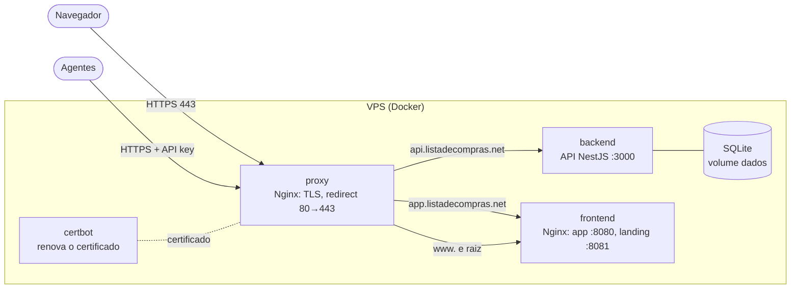

# Lista de Ações

[](https://github.com/rattones/lista-acoes/actions/workflows/ci.yml)

Gerenciador de ações: acompanha o mercado, armazena os dados coletados por agentes e apoia a decisão de compra e venda.

## Visão geral

- **Agentes coletores** (etapa futura) enviam à API os preços diários e as notícias dos ativos monitorados, autenticados por API key.
- Um **agente de decisão** externo (etapa futura) lê esses dados e grava a nota de cada ativo (1 a 5). A API só armazena e fornece os dados; ela não calcula a nota.
- O **app** mostra o dashboard, os ativos monitorados e os usuários. O acesso é só por convite: não existe cadastro aberto.
- A **landing page** apresenta o projeto e leva ao app.
- **Bots** de compra e venda na XP Investimentos ficam para o fim do projeto.

Situação atual: fundação pronta (monorepo, Docker em DEV e PROD, HTTPS, CI) e executor de migrations do banco. O schema, o CRUD e a autenticação são as próximas etapas ([issues](https://github.com/rattones/lista-acoes/issues) e [projeto](https://github.com/users/rattones/projects/2)).

## Arquitetura

Em PROD, tudo roda em containers Docker numa VPS. Só o proxy publica portas e escolhe o destino pelo subdomínio:



Em DEV (servidor casa-ratton), não há proxy: cada serviço usa sua porta (API 3000, app 8080, landing 8081).

## Stack

| Camada         | Tecnologia                                                                  |
| -------------- | --------------------------------------------------------------------------- |
| Backend        | Node.js 24, NestJS 11 em JavaScript (Babel 7), Joi, pino                    |
| Banco          | SQLite com better-sqlite3 e SQL puro, migrations `.sql` versionadas         |
| Frontend       | Vue 3, Vite, Vuetify, Pinia, Vue Router; Chart.js no dashboard (tarefa 024) |
| Testes         | Jest + Supertest (backend), Vitest + Vue Test Utils (frontend)              |
| Infraestrutura | Docker Compose, Nginx, Let's Encrypt (certbot), GitHub Actions              |
| E-mail         | Gmail SMTP com nodemailer (tarefa 013)                                      |

## Estrutura

Monorepo com npm workspaces:

| Pasta       | Conteúdo                                                     |
| ----------- | ------------------------------------------------------------ |
| `backend/`  | API (NestJS) — `api.listadecompras.net`                      |
| `frontend/` | App (Vue) e landing page — `app.` e `www.listadecompras.net` |
| `infra/`    | Docker, Nginx e scripts                                      |

## Comandos (na raiz)

| Comando             | O que faz                                                              |
| ------------------- | ---------------------------------------------------------------------- |
| `npm install`       | Instala as dependências da raiz e dos workspaces                       |
| `npm test`          | Verifica a estrutura do repositório e roda os testes de cada workspace |
| `npm run lint`      | ESLint e verificação de formatação do Prettier                         |
| `npm run format`    | Formata os arquivos com o Prettier                                     |
| `npm run dev`       | Sobe o ambiente de desenvolvimento de cada workspace                   |
| `npm run smoke:dev` | Smoke test do ambiente DEV no Docker (containers no ar)                |

## Como rodar em DEV

Com Docker, no servidor casa-ratton (API 3000, app 8080, landing 8081, com hot reload):

```sh
docker compose -f infra/docker-compose.dev.yml up -d --build
docker compose -f infra/docker-compose.dev.yml exec backend npm run db:migrate -w backend
docker compose -f infra/docker-compose.dev.yml exec backend npm run db:admin -w backend -- --email <e-mail> --nome <nome>
npm run smoke:dev
```

Sem Docker, com Node 24 (`nvm use`):

```sh
npm install
cp backend/.env-example backend/.env
npm run db:migrate -w backend
npm run db:admin -w backend -- --email <e-mail> --nome <nome>
npm run dev
```

Hostnames, firewall e variáveis: [INSTALL.md](INSTALL.md#ambiente-dev-com-docker-servidor-casa-ratton).

## Como testar

O desenvolvimento segue TDD: o teste novo é escrito antes e precisa falhar antes da implementação.

| Comando                  | O que testa                                                |
| ------------------------ | ---------------------------------------------------------- |
| `npm test`               | Tudo: estrutura do repositório, backend e frontend         |
| `npm run test:estrutura` | Estrutura do monorepo, `.gitignore` e documentação base    |
| `npm test -w backend`    | Unitários e e2e da API (banco SQLite em memória)           |
| `npm test -w frontend`   | Componentes, rotas e cliente HTTP do app e da landing      |
| `npm run lint`           | ESLint e Prettier                                          |
| `npm run smoke:dev`      | Ambiente DEV no ar (containers rodando)                    |
| `npm run smoke:prod`     | Stack de PROD local com certificado de teste (ver INSTALL) |
| `npm run verifica:https` | Certificado, HSTS e redirect nos hosts reais de PROD       |

O CI roda lint, estrutura, testes, builds e o smoke de PROD em todo pull request (ver [Integração contínua](#integração-contínua)).

## Backend (API)

NestJS em JavaScript (decorators via Babel 7), com todas as rotas sob o prefixo `/v1`. Os decorators de parâmetro (`@Body()`, `@Query()`, `@Inject()` no construtor...) são convertidos por um plugin local no `backend/babel.config.js`, no formato do `__param` do TypeScript.

| Comando                                                         | O que faz                                        |
| --------------------------------------------------------------- | ------------------------------------------------ |
| `npm run dev -w backend`                                        | Sobe a API com recarga automática (porta `PORT`) |
| `npm test -w backend`                                           | Testes unitários e e2e (Jest + Supertest)        |
| `npm run build -w backend`                                      | Transpila `src/` para `dist/`                    |
| `npm run start -w backend`                                      | Executa a versão transpilada                     |
| `npm run db:migrate -w backend`                                 | Aplica as migrations pendentes do banco          |
| `npm run db:status -w backend`                                  | Lista as migrations aplicadas e pendentes        |
| `npm run db:admin -w backend -- --email <e-mail> --nome <nome>` | Cria um usuário admin (pede a senha)             |

| Rota             | Resposta                                |
| ---------------- | --------------------------------------- |
| `GET /v1/health` | `{ "status": "ok", "versao": "x.y.z" }` |

### CRUD dos recursos

Recursos: `ativos`, `execucoes`, `sinais`, `precos` (tabela `precos_diarios`), `noticias` e `usuarios`. Por enquanto as rotas não exigem autenticação: os guards e a restrição de `incluir_excluidos` e `permanente` a admin entram na tarefa 012.

| Rota                                       | O que faz                                                                            |
| ------------------------------------------ | ------------------------------------------------------------------------------------ |
| `GET /v1/{recurso}`                        | Lista paginada: `{ dados, paginacao: { pagina, por_pagina, total, total_paginas } }` |
| `GET /v1/{recurso}/:id`                    | Obtém um registro (404 se não existe ou está excluído)                               |
| `POST /v1/{recurso}`                       | Cria (201); não existe para `usuarios` (cadastro só por convite, tarefa 015)         |
| `PATCH /v1/{recurso}/:id`                  | Atualiza só os campos enviados (ao menos um)                                         |
| `DELETE /v1/{recurso}/:id`                 | Exclusão lógica (204): preenche `excluido_em`                                        |
| `DELETE /v1/{recurso}/:id?permanente=true` | Exclusão física (204), inclusive de registro já excluído                             |
| `POST /v1/{recurso}/:id/restaurar`         | Desfaz a exclusão lógica (409 se o registro não está excluído)                       |
| `POST /v1/precos/lote`                     | Upsert de até 1000 preços por `(ativo_id, data)`: `{ inseridos, atualizados }`       |
| `POST /v1/noticias/lote`                   | Upsert de até 1000 notícias pela `url`: `{ inseridos, atualizados }`                 |

- **Listagem:** `pagina` (padrão 1), `por_pagina` (padrão 20, máximo 100), `ordenar` (`campo` ou `-campo` para decrescente; padrão `id`), filtros de igualdade por recurso (ex.: `ativos?status=inativo&tipo=acao`) e `incluir_excluidos=true`. Parâmetro desconhecido responde 400.
- **Validação:** esquemas Joi de cada recurso, com os mesmos valores permitidos pelos `CHECK` do schema. Campo desconhecido responde 400.
- **Conflitos:** valor único repetido (ex.: código de ativo, URL de notícia) → 409 `conflito`, com o campo em `detalhes`; registro relacionado inexistente (ex.: `ativo_id`) → 422 `entidade_invalida`.
- **Lotes:** gravados numa transação (se um item falhar, nada é gravado). No conflito, só os campos enviados são alterados, e um registro excluído logicamente continua excluído.
- **Booleanos** (`concordam`, `mm50_subindo`, `usuarios.ativo`...) são aceitos como `true`/`false` e devolvidos como `1`/`0`.
- **Sinais:** o código do ativo (`ativo`) é preenchido a partir do `ativo_id` e não é aceito no payload.
- **Usuários:** `senha_hash` nunca sai da API. Pelo `PATCH`, só `nome`, `papel` e `ativo` (o e-mail não muda; a senha tem fluxo próprio).
- **Corpo das requisições:** JSON de até 1 MB.

- **Erros:** toda resposta de erro segue o formato `{ "erro": "codigo", "mensagem": "texto", "detalhes": ... }`, com códigos como `requisicao_invalida` (400), `nao_encontrado` (404), `conflito` (409), `payload_muito_grande` (413), `entidade_invalida` (422) e `erro_interno` (500).
- **Validação:** payloads são validados com esquemas Joi (`ValidacaoPipe`); a falha responde 400 com a lista de campos em `detalhes`.
- **Configuração:** variáveis de ambiente validadas na inicialização; a API não sobe se faltar alguma obrigatória (ver `backend/.env-example`).
- **Logs:** JSON (pino), com request id em cada linha; o `x-request-id` recebido é reaproveitado ou gerado e devolvido na resposta. A linha de cada requisição tem só `id`, `method`, `url`, `remoteAddress`, `userAgent`, o `statusCode` e o `responseTime`: nenhum cabeçalho é gravado, então credenciais (`Authorization`, `Cookie`, `X-Api-Key`, `Set-Cookie`) nunca chegam ao log. Campos `senha`, `senha_hash` e `token` em objetos registrados pelo código saem como `[oculto]` (`src/comum/log.js`).
- **Rotação dos logs:** todos os containers (DEV e PROD) usam `json-file` com até 5 arquivos de 10 MB por serviço.
- **CORS:** liberado somente para as origens em `CORS_ORIGENS`.
- **Banco:** SQLite (better-sqlite3, SQL puro) no arquivo `DB_ARQUIVO` (padrão `data/monitor.db`). O `DatabaseModule` abre uma conexão única com `foreign_keys = ON`, `journal_mode = WAL` e `busy_timeout = 5000`, injetada com `@Dependencies(CONEXAO_DB)`, e a fecha quando a API encerra.
- **Migrations:** arquivos `backend/migrations/NNNN_descricao.sql`, aplicados em ordem pelo `db:migrate`, cada um em uma transação e registrado em `schema_migrations (versao, nome, aplicada_em)`. Migration já registrada não roda de novo; se uma falhar, ela é desfeita e as seguintes não rodam. A API não aplica migrations ao iniciar.
- **Schema** (`0001_schema_inicial.sql`): `ativos`, `execucoes`, `sinais` (ligados a `ativos` por `ativo_id`), `precos_diarios`, `noticias`, `usuarios` e `agentes_tokens`, todas com exclusão lógica por `excluido_em` (NULL = registro ativo), e as views `v_ativos_monitorados` (`status = 'ativo'`), `v_resumo_atual`, `v_historico_nota` e `v_proximos_eventos`, que ignoram registros excluídos. Apagar fisicamente um ativo apaga seus preços e sinais (notícias perdem o vínculo); apagar um usuário apaga suas API keys. Referência completa: `.context/SCHEMA.sql`.
- **Carga inicial** (`0002_carga_inicial.sql`): os 6 ativos do início do projeto (CSCO, GOOGL, ORCL, PETR4, TSLA e USDT-BRL). O primeiro admin não é versionado: é criado com `db:admin`.
- **Senhas:** hash argon2id (`@node-rs/argon2`) e mínimo de 10 caracteres (`src/auth/senha.js`).

## Frontend (app e landing page)

Vue 3 + Vite + Vuetify + Pinia + Vue Router, em JavaScript. São dois alvos com builds separados, cada um servido pelo seu host:

| Alvo      | Código              | Build          | Porta (DEV) | Host                     |
| --------- | ------------------- | -------------- | ----------- | ------------------------ |
| App (SPA) | `frontend/app/`     | `dist/app`     | 8080        | `app.listadecompras.net` |
| Landing   | `frontend/landing/` | `dist/landing` | 8081        | `www.listadecompras.net` |

| Comando                           | O que faz                                  |
| --------------------------------- | ------------------------------------------ |
| `npm run dev -w frontend`         | Sobe o app com recarga automática          |
| `npm run dev:landing -w frontend` | Sobe a landing page com recarga automática |
| `npm test -w frontend`            | Testes (Vitest + Vue Test Utils)           |
| `npm run build -w frontend`       | Gera `dist/app` e `dist/landing`           |
| `npm run preview -w frontend`     | Serve o build do app                       |

- **API:** o cliente em `app/src/api/cliente.js` usa `VITE_API_URL` como base; erros no formato `{ erro, mensagem, detalhes }` viram `ErroApi` (com `status`, `codigo`, `message` e `detalhes`).
- **Rotas:** `/` (início) e 404 para qualquer rota desconhecida, mantendo o endereço digitado. O app usa histórico HTML5, então o servidor precisa devolver o `index.html` para rotas desconhecidas.
- **Tema:** claro e escuro, alternados pela barra superior; o inicial segue a preferência do sistema.
- **Landing page:** o link "Acessar o app" usa `VITE_APP_URL` (padrão: `https://app.listadecompras.net`). Não tem link de cadastro: usuários entram por convite.

## Produção (Docker + Nginx)

`docker compose -f infra/docker-compose.prod.yml up -d --build --wait` sobe o proxy Nginx (portas 80 e 443), a API, o frontend e o certbot. O proxy roteia por subdomínio: `api.` vai para a API, `app.` para o app, e `www.` e o domínio raiz para a landing page. Tudo é servido em HTTPS com certificado da Let's Encrypt (renovação automática), e o HTTP redireciona com 301. `npm run smoke:prod` testa a stack e `npm run verifica:https` confere o certificado de PROD. Detalhes no [INSTALL.md](INSTALL.md#produção-vps-com-docker-e-nginx).

## Integração contínua

O GitHub Actions (`.github/workflows/ci.yml`) roda a cada push na `main` e em todo pull request, com quatro jobs em paralelo:

| Job                        | O que verifica                                                           |
| -------------------------- | ------------------------------------------------------------------------ |
| Lint e estrutura           | `npm run lint` e `npm run test:estrutura`                                |
| Testes do backend          | `npm test -w backend` e `npm run build -w backend`                       |
| Testes e build do frontend | `npm test -w frontend` e `npm run build -w frontend`                     |
| Imagens e smoke de PROD    | Build das imagens de PROD (sem push), stack no ar e `npm run smoke:prod` |

A `main` é protegida: os quatro jobs são checks obrigatórios, inclusive para administradores. Um PR só pode ser mergeado com todos verdes e com a branch atualizada em relação à `main`. Push direto, force push e exclusão da `main` estão bloqueados.

## Documentação

- [INSTALL.md](INSTALL.md): requisitos, variáveis de ambiente, DEV (portas e firewall) e PROD (VPS, Docker e SSL).
- [CHANGELOG.md](CHANGELOG.md): histórico de mudanças.
- [POLICY.md](POLICY.md): política de privacidade.
